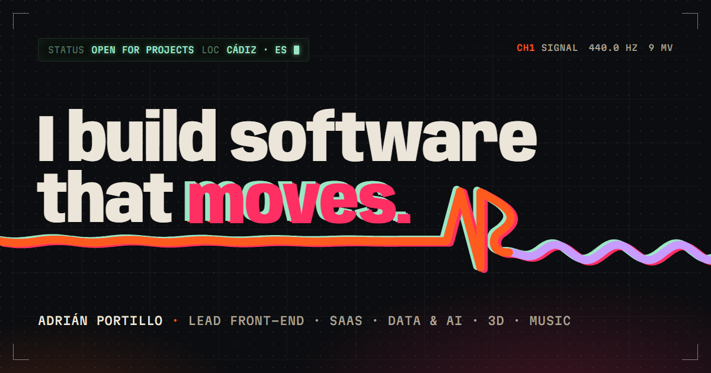

<p align="center">
  
</p>

# Señal · Adrián Portillo's portfolio

A scroll-driven 3D story instead of a CV. A live oscilloscope signal writes the AP logo in the hero, the camera flies over a particle terrain past animated dioramas of each project, and along the way you can play a drum machine, fly a rhythm game, shoot the scenery and unlock achievements.

**Español** en [`/`](index.html) · **English** at [`/en/`](src/i18n-page.js)

## What's inside

| Chapter | Interaction |
|---|---|
| **Signal** (hero) | Canvas oscilloscope trace that becomes the logo; pluck it, and it reacts to the pointer and the music |
| **Origin · Craft · Lab** | Three.js dioramas (drones, trucks and a gantry crane, a radar city, a QR being scratched…) placed along the camera path |
| **Skills** | Each discipline reshapes the terrain shader |
| **Athetosis** | **ATH-16**: a 16-step drum machine + mono synth, fully synthesized with Web Audio (boom bap, breakbeat, garage, DnB…, swing and glitch) |
| **Arcade** | **Signal Run**: a rhythm runner that plays to the ATH-16 at 174 BPM |
| **Contact** | Form sent through a Vercel function with nodemailer |

Plus a probe cursor, click-to-shoot (breakable wireframe props and terrain shockwaves), 11 achievements, a Konami-code 8-bit mode and a status LCD that decodes new messages on hover.

## Stack

Vite · Three.js (custom shaders) · GSAP + ScrollTrigger · Lenis · Web Audio · Canvas 2D · nodemailer on Vercel Functions. No UI framework.

- **Fonts and icons are self-hosted** (Fontsource, Iconify subset): no requests to third parties until you choose to load the Spotify player.
- **Two real pages for SEO**: `/en/index.html` is generated at build time from `index.html` + `src/i18n-page.js`, with `canonical`, `hreflang` and a sitemap.
- **Respects `prefers-reduced-motion`**: static poster instead of WebGL, no smooth scroll or scrubbed animations.
- Strict CSP and security headers in [`vercel.json`](vercel.json), and the same headers in `vite preview` so they can be tested locally.

## Run it

```bash
npm install
npm run dev        # http://localhost:5173 (includes /api/contact)
npm test           # contact API validation tests
npm run build      # dist/ with /, /en/, /legal/
npm run preview    # production build with production headers
npm run icons      # regenerate src/icons.json after using a new icon
```

### Environment

Copy `.env.example` to `.env`:

| Variable | Purpose |
|---|---|
| `SMTP_HOST`, `SMTP_PORT`, `SMTP_USER`, `SMTP_PASS` | SMTP account for the contact form (Gmail: use an App Password) |
| `CONTACT_TO`, `CONTACT_FROM` | Where messages arrive and the sender address |
| `SITE_URL` | Public URL without a trailing slash; enables absolute `canonical`/`hreflang`/`og:image` and `sitemap.xml` |

## Deploy

Built for **Vercel**: import the repo, set the variables above, deploy. `api/contact.js` becomes a serverless function automatically.

## Structure

```
index.html            Spanish page (source of truth)
src/i18n-page.js      English copy, applied at build time
src/scene.js          Terrain shader, camera path, dioramas, shooting
src/hero-signal.js    Hero oscilloscope trace
src/machine*.js       ATH-16 drum machine (engine + UI)
src/game*.js          Signal Run (logic + rendering)
api/contact.js        Contact form endpoint (+ tests)
brand/                Logo kit, usage guide and share-image source
legal/                Legal notice, privacy and cookies (ES/EN)
```

## License

Code © Adrián Portillo Sánchez. You're welcome to read it and learn from it; please don't redeploy it as your own portfolio. The logo and brand assets in `brand/` are not licensed for reuse.
